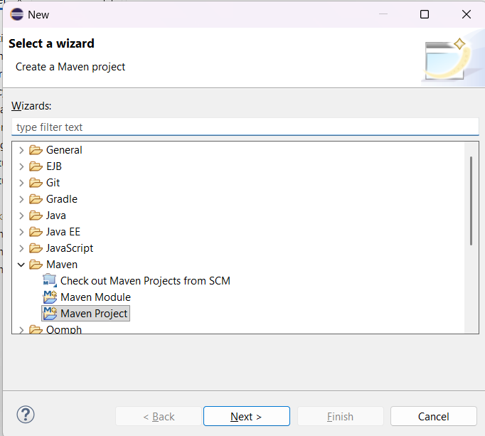
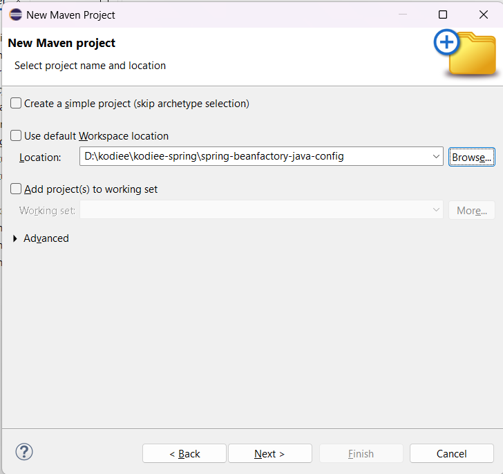
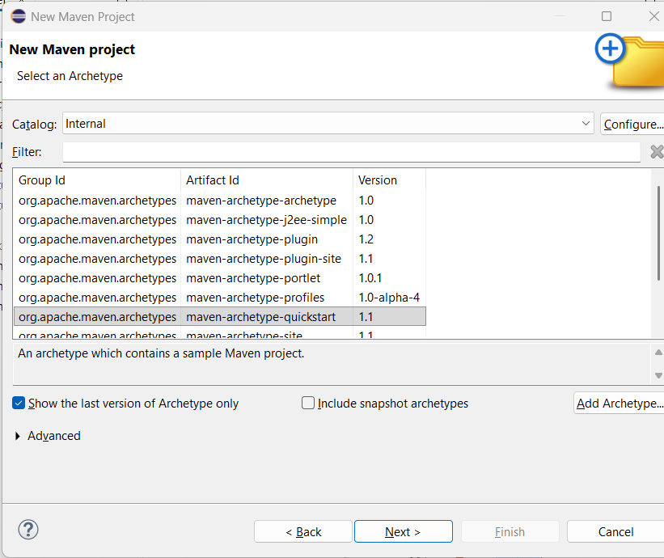
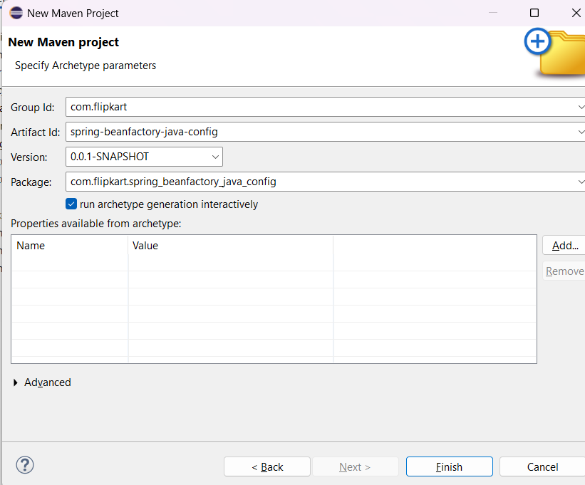
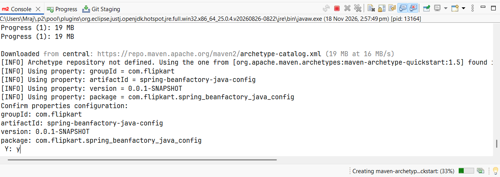
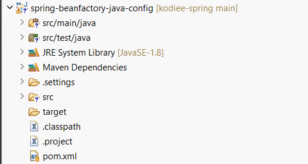

# Spring Beans using Java Config with BeanFactory

This project shows how to create Spring beans using **Java configuration** (`@Configuration` and `@Bean`) with **`BeanFactory`** as the IoC Container.

The example is a simple order flow: `OrderService` depends on `OrderRepository`, and Spring creates both beans and injects the dependency through the constructor.

## Prerequisites

* Java 17
* Maven
* Eclipse IDE
* Git

## IoC Container

There are two types of IoC Container:

1. `BeanFactory`
2. `ApplicationContext`

### 1. `BeanFactory`

* BeanFactory is one of the types of Spring IoC Container.
* It is the root interface of the Spring IoC Container which is responsible for providing basic bean management and dependency injection functionality.
* It is the most basic container which gives only basic features.
* `BeanFactory` uses lazy loading.
* The implementation of `BeanFactory` is `DefaultListableBeanFactory`.
* Because of its limited features, `BeanFactory` is rarely used directly in real applications.

---

## Step 1: Create the Maven Project

Inside Eclipse:

1. Go to **File >> New >> Maven Project**.

   

2. Click **Next** and set the workspace location.

   

3. Click **Next** and select:
   * Catalog: `Internal`
   * Group Id: `org.apache.maven.archetypes`
   * Artifact Id: `maven-archetype-quickstart`
   * Version: `1.1`

   

4. Click **Next** and fill in the details, then click **Finish**:
   * Group Id: `com.flipkart`
   * Artifact Id: `spring-beanfactory-java-config`
   * Version: `0.0.1-SNAPSHOT`
   * Package: `com.flipkart.spring_beanfactory_java_config`

   

5. In the console, type `y` and hit **Enter**.

   

6. The project is now visible inside the Package Explorer.

   

---

## Step 2: Add Spring Context Dependency

Add the `spring-context` dependency inside `<dependencies>` in `pom.xml`.
Dependency link: <https://mvnrepository.com/artifact/org.springframework/spring-context/6.1.21>

```xml
<dependency>
    <groupId>org.springframework</groupId>
    <artifactId>spring-context</artifactId>
    <version>6.1.21</version>
</dependency>
```

Spring 6 needs Java 17, so make sure the project is using Java 17.

---

## Step 3: Create the Classes

Create these four classes (full code is available in the [PDF](./spring-beanfactory-java-config.pdf)).

| Class | Package | Purpose |
|---|---|---|
| `OrderRepository` | `repository` | Data layer class. |
| `OrderService` | `service` | Business layer class. |
| `SpringConfig` | `config` | Java configuration class. |
| `App` | `com.flipkart.spring_beanfactory_java_config` | Main class that creates the `BeanFactory` and gets the bean. |

* **`OrderRepository`**
  * A normal Java class with a `saveOrder()` method.
  * It prints `Order saved to database.`

* **`OrderService`**
  * It has an `OrderRepository` object (HAS-A relationship).
  * The `OrderRepository` is injected through the constructor (constructor dependency injection).
  * Its `placeOrder()` method prints `Placing order...` and then calls `saveOrder()` of `OrderRepository`.

* **`SpringConfig`**
  * `@Configuration` tells Spring that this class contains bean definitions.
  * `@Bean` on a method tells Spring to manage the returned object as a bean.
  * `orderRepository()` creates the `OrderRepository` bean.
  * `orderService()` creates the `OrderService` bean with the name `orderService` and passes `orderRepository()` into its constructor.

* **`App`**
  * It creates the `BeanFactory`, registers `SpringConfig`, gets the `OrderService` bean and calls `placeOrder()`.

---

## Project Structure

```text
spring-beanfactory-java-config
├── docs
│   ├── README.md
│   ├── spring-beanfactory-java-config.pdf
│   └── images
├── src
│   └── main
│       └── java
│           └── com
│               └── flipkart
│                   └── spring_beanfactory_java_config
│                       ├── App.java
│                       ├── config
│                       │   └── SpringConfig.java
│                       ├── repository
│                       │   └── OrderRepository.java
│                       └── service
│                           └── OrderService.java
├── .gitignore
└── pom.xml
```

---

## How `App.java` Works

1. **Creating `BeanFactory` (IoC Container)**
   * `DefaultListableBeanFactory` is created. This is our IoC Container.

2. **Creating `AnnotatedBeanDefinitionReader`**
   * It registers classes containing Spring annotations as bean definitions.

3. **Registering `SpringConfig` class with `BeanFactory`**
   * `SpringConfig` contains `@Configuration` and `@Bean` annotations.

4. **Creating `ConfigurationClassPostProcessor`**
   * It processes `@Configuration` and `@Bean` annotations.

5. **Processing the registered configuration class**
   * It identifies `@Bean` methods and registers their bean definitions inside `BeanFactory`.

6. **Processing the `BeanFactory`**
   * It performs additional processing of the `BeanFactory` after registering the bean definitions.

7. **Retrieving `OrderService` bean using its bean name and type**
   * `getBean("orderService", OrderService.class)` gives us the `OrderService` bean.

8. **Calling the business method**
   * `placeOrder()` is called on the bean.

---

## Why do we need `ConfigurationClassPostProcessor`?

* `BeanFactory` is a basic container. It does not understand `@Configuration` and `@Bean` on its own.
* `ConfigurationClassPostProcessor` reads the `@Configuration` class, finds all the `@Bean` methods and registers them as bean definitions inside the `BeanFactory`.
* `ApplicationContext` does this work automatically. With `BeanFactory`, we have to do it manually.
* It also makes sure that when `orderService()` calls `orderRepository()`, Spring gives the same `OrderRepository` bean. A new object is not created every time.

## Lazy Loading in `BeanFactory`

* `BeanFactory` creates a bean only when it is requested.
* In this project, the `OrderService` bean (and the `OrderRepository` bean it needs) is created only when `getBean("orderService", OrderService.class)` is called in step 7.
* Registering the configuration class in the earlier steps only stores the bean definitions. No bean object is created at that time.

---

## `.gitignore`

Create a `.gitignore` file in the project root:

```gitignore
# Maven build output
target/

# Eclipse
.classpath
.project
.settings/
bin/

# Other IDEs
.idea/
*.iml
.vscode/

# Compiled files and logs
*.class
*.log

# OS files
.DS_Store
Thumbs.db
```

---

## Run the Project

Open `App.java`, right-click >> **Run As >> Java Application**.

### Output

```text
Placing order...
Order saved to database.
```

---

## Clone the Project Locally

1. Open a terminal and run:
   ```bash
   git clone https://github.com/hiaadityahere/spring-framework-projects.git
   cd spring-framework-projects/spring-beanfactory-java-config
   ```
2. Open Eclipse and go to **File >> Import >> Maven >> Existing Maven Projects >> Next**.
3. Click **Browse**, select the `spring-beanfactory-java-config` folder inside the cloned repository, and click **Finish**.
4. Wait for Maven to download the dependencies, or right-click the project >> **Maven >> Update Project** (Alt+F5).
5. Open `App.java`, right-click >> **Run As >> Java Application**.